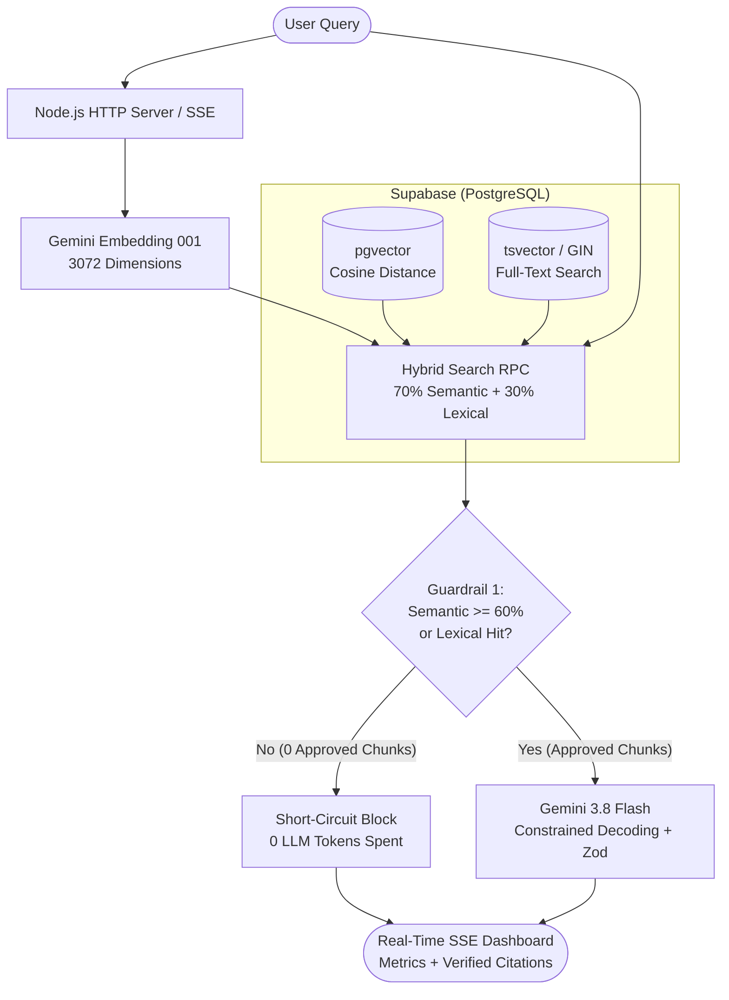
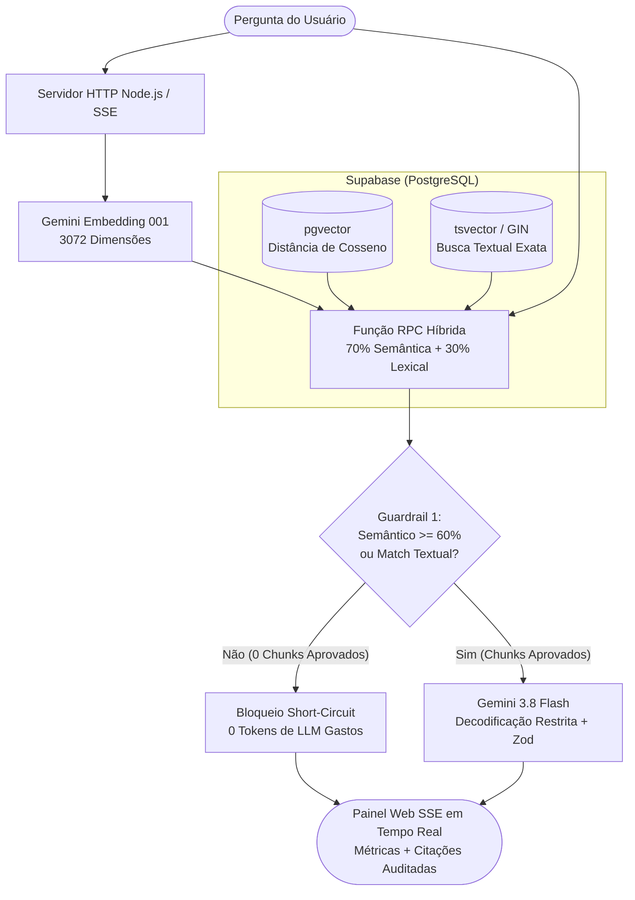

# Enterprise Hybrid-RAG Engine (TypeScript + pgvector + Zod)

<a id="top"></a>

## Navigation Menu / Menu de Navegação

| 🇺🇸 English Documentation | 🇧🇷 Documentação em Português |
| :--- | :--- |
| [Overview](#english-documentation) | [Visão Geral](#documentação-em-português) |
| [1. System Architecture (Diagram)](#1-system-architecture) | [1. Arquitetura do Sistema (Diagrama)](#1-arquitetura-do-sistema) |
| [2. Key Engineering Highlights](#2-key-engineering-highlights) | [2. Diferenciais de Engenharia](#2-diferenciais-de-engenharia) |
| [3. Benchmark & Token Optimization](#3-benchmark--token-optimization) | [3. Benchmark e Otimização de Tokens](#3-benchmark-e-otimização-de-tokens) |
| [4. Repository Structure (5 Stages)](#4-repository-structure) | [4. Estrutura do Repositório (5 Etapas)](#4-estrutura-do-repositório) |
| [5. Database Setup (Supabase SQL)](#5-database-setup-supabase-sql) | [5. Configuração do Banco de Dados (SQL)](#5-configuração-do-banco-de-dados-sql) |
| [6. Quick Start & Execution](#6-quick-start--execution) | [6. Como Executar o Projeto](#6-como-executar-o-projeto) |
| [7. Customizing the Knowledge Base](#7-customizing-the-knowledge-base-sample-data) | [7. Personalizando a Base de Conhecimento](#7-personalizando-a-base-de-conhecimento-dados-de-teste) |

---

## English Documentation

> [Mudar para Português 🇧🇷](#documentação-em-português)

A production-grade **Retrieval-Augmented Generation (RAG)** engine built from scratch with **Node.js**, **TypeScript 6**, **Supabase (`pgvector` + Full-Text Search)**, **Vercel AI SDK**, and **Google Gemini (`gemini-3.8-flash` & `gemini-embedding-001`)**.

Unlike basic RAG tutorials that rely purely on vector similarity and unstructured text prompts, this project addresses the three biggest challenges of enterprise AI systems in production: **hallucination on missing data**, **semantic search failure on exact technical codes/acronyms**, and **uncontrolled token costs**.

### 1. System Architecture



### 2. Key Engineering Highlights

* **Hybrid Retrieval in PostgreSQL (70% Semantic + 30% Lexical):**
  Combines dense semantic embeddings (`gemini-embedding-001` with 3,072 dimensions via `pgvector`) and native lexical keyword matching (`to_tsvector` + GIN index) directly inside a PostgreSQL RPC function. This guarantees high accuracy for both conceptual questions (*"buying a chair and monitor for home office"*) and exact technical codes (*`ERR-904-DB`*, *`Ed25519`*).
* **Two-Layer Anti-Hallucination Guardrails (Over 70% Token Savings):**
  * **Layer 1 — Code-Level Hard Threshold (Short-Circuit):** Discards retrieved chunks that score below `60%` semantic similarity (unless backed by a lexical match). If zero chunks pass the filter, the Node.js backend aborts the workflow immediately without calling the LLM (**0 generation tokens spent**).
  * **Layer 2 — Schema-Enforced Partial Abstention:** Uses **Zod** (`Output.object`) and Constrained Decoding to force the LLM to answer *only* what is proven in the approved chunks (extracting page numbers and verbatim quotes) while isolating unverified sub-questions into a dedicated `topicosSemEvidencia` array.
* **Real-Time SSE Streaming & LLMOps Telemetry Dashboard:**
  Built-in dark-mode web interface powered by **Server-Sent Events (SSE)** (`partialOutputStream`). Displays approved/discarded database chunks in real time, streams structured JSON fields as they are generated, and monitors total latency, token usage, and estimated USD cost per query.

### 3. Benchmark & Token Optimization

| Evolution Stage | Retrieval & Generation Strategy | Tokens Spent | Anti-Hallucination Protection |
| :--- | :--- | :---: | :--- |
| **Stage 1 (`index.ts`)** | Raw document context + single citation schema | 1,121 tokens | Basic (System Prompt only) |
| **Stage 2 (`rag-local.ts`)** | Automated Chunking + Top-2 Semantic Filter | 851 tokens | Multi-Citation Array Schema |
| **Stage 4 (`rag-guardrails.ts`)** | Hybrid Search + 60% Threshold + `thinkingBudget: 0` | **327 tokens** | **Partial Abstention + Code Guardrail** |
| **Out-of-Scope Query** | Blocked at Code-Level Guardrail (Short-Circuit) | **0 tokens** | **100% Blocked before LLM Call** |

### 4. Repository Structure

The codebase is organized into 5 progressive engineering stages:

* `src/index.ts` — **Stage 1:** Strict contract validation with TypeScript, Zod, and Constrained Decoding (`Output.object`).
* `src/embeddings.ts` — **Stage 2A:** Batch vectorization (`embedMany`) with `gemini-embedding-001` (3,072 dimensions) and Cosine Similarity ranking.
* `src/rag-local.ts` — **Stage 2B:** Automated regex document chunker, Top-K filtering, and multi-citation array extraction.
* `src/hybrid-rag.ts` — **Stage 3:** Supabase `pgvector` persistence and Hybrid Search (Semantic + Full-Text Search).
* `src/rag-guardrails.ts` — **Stage 4:** Hard threshold filtering (`0.60`), Short-Circuit execution, and partial abstention auditing.
* `src/server.ts` — **Stage 5:** Full-Stack SSE Streaming HTTP API + Real-Time LLMOps Web Dashboard.

### 5. Database Setup (Supabase SQL)

Open the **SQL Editor** in your Supabase dashboard and run the following migration script:

```sql
-- 1. Enable the pgvector extension for vector similarity search
create extension if not exists vector;

-- 2. Create the knowledge base table (3072 dimensions + automatic Full-Text Search index)
create table if not exists documentos_rag (
  id bigserial primary key,
  pagina int not null,
  conteudo text not null,
  embedding vector(3072) not null,
  fts tsvector generated always as (to_tsvector('portuguese', conteudo)) stored
);

-- 3. Create a fast GIN index for lexical keyword search
create index if not exists documentos_rag_fts_idx on documentos_rag using gin(fts);

-- 4. Create the Hybrid Search RPC function (70% Semantic + 30% Lexical)
create or replace function buscar_documentos_hibrido(
  query_text text,
  query_embedding vector(3072),
  match_count int default 3
)
returns table (
  id bigint,
  pagina int,
  conteudo text,
  score_semantico float,
  score_textual float,
  score_hibrido float
)
language sql
as $$
  select
    d.id,
    d.pagina,
    d.conteudo,
    (1 - (d.embedding <=> query_embedding))::float as score_semantico,
    ts_rank(d.fts, websearch_to_tsquery('portuguese', query_text))::float as score_textual,
    (
      (1 - (d.embedding <=> query_embedding)) * 0.7 +
      least(ts_rank(d.fts, websearch_to_tsquery('portuguese', query_text)), 1.0) * 0.3
    )::float as score_hibrido
  from documentos_rag d
  order by score_hibrido desc
  limit match_count;
$$;
```

### 6. Quick Start & Execution

#### 1. Clone the repository and install dependencies
```bash
git clone https://github.com/marcus-piccoli/enterprise-hybrid-rag.git
cd enterprise-hybrid-rag
npm install
```

#### 2. Configure Environment Variables
Create a `.env` file in the project root directory:
```env
GOOGLE_GENERATIVE_AI_API_KEY="your_google_ai_studio_api_key"
SUPABASE_URL="[https://your-project-id.supabase.co](https://your-project-id.supabase.co)"
SUPABASE_KEY="your_supabase_anon_or_service_role_key"
```

#### 3. Run the Stages & Web Dashboard
```bash
# Stage 1: Test basic structured output validation
npx tsx src/index.ts

# Stage 2: Test local chunking and semantic similarity
npx tsx src/embeddings.ts
npx tsx src/rag-local.ts

# Stage 3: Populate Supabase pgvector and test Hybrid Search
npx tsx src/hybrid-rag.ts

# Stage 4: Run the Anti-Hallucination & Short-Circuit test suite
npx tsx src/rag-guardrails.ts

# Stage 5: Launch the Real-Time Streaming Web Dashboard (http://localhost:3000)
npx tsx src/server.ts
```

### 7. Customizing the Knowledge Base (Sample Data)

> **Important Note:** To make this repository immediately testable out-of-the-box without requiring external files, the source code includes built-in **sample corporate policy texts** (covering remote work equipment reimbursement, SSH key rotation, vacation rules, and `ERR-904-DB` database contingency protocols).

You should modify or replace these texts according to your own domain or business needs:

* **In Local Stages (`src/index.ts`, `src/embeddings.ts`, `src/rag-local.ts`):**
  Simply edit the string constants (`documentoFicticio`, `baseConhecimento`, or `manualCorporativoBruto`) directly inside each file.
* **In Supabase Database Stages (`src/hybrid-rag.ts`, `src/rag-guardrails.ts`, `src/server.ts`):**
  1. Open `src/hybrid-rag.ts` and replace the text inside the `manualBruto` constant with your own documentation (keep the `[Página X]` markers separated by blank lines so the automatic chunker can identify each page).
  2. If you have already run the script before, clear the previous sample data in your Supabase **SQL Editor** by running:
     ```sql
     truncate table documentos_rag restart identity;
     ```
  3. Run `npx tsx src/hybrid-rag.ts` again. The script will detect that the table is empty, generate new 3,072-dimension embeddings for your custom text, and save them to Supabase.
  4. Optionally, update the preset test buttons in `src/server.ts` (`PAGINA_HTML`) to match questions relevant to your new documents.

[⬆️ Back to Top / Voltar ao Topo](#top)

---

## Documentação em Português

> [Switch to English 🇺🇸](#english-documentation)

Motor corporativo de **RAG Híbrido (Retrieval-Augmented Generation)** construído do zero com **Node.js**, **TypeScript 6**, **Supabase (`pgvector` + Full-Text Search)**, **Vercel AI SDK** e **Google Gemini (`gemini-3.8-flash` & `gemini-embedding-001`)**.

Diferente de tutoriais básicos de RAG que dependem apenas de similaridade vetorial simples e prompts de texto livre, este projeto resolve os três maiores gargalos de sistemas de IA em produção: **alucinação sobre dados inexistentes**, **falha da busca semântica em siglas/códigos técnicos exatos** e **custo elevado de tokens**.

### 1. Arquitetura do Sistema



### 2. Diferenciais de Engenharia

* **Busca Híbrida no PostgreSQL (70% Semântica + 30% Lexical):**
  Combina embeddings semânticos densos (`gemini-embedding-001` com 3.072 dimensões via `pgvector`) e busca textual nativa por palavras-chave (`to_tsvector` + índice GIN) diretamente em uma função RPC no banco de dados. Isso garante alta precisão tanto para perguntas conceituais (*"comprar cadeira e monitor para home office"*) quanto para códigos técnicos exatos (*`ERR-904-DB`*, *`Ed25519`*).
* **Guardrails Anti-Alucinação em Duas Camadas (Economia superior a 70% em Tokens):**
  * **Camada 1 — Nota de Corte Rígida em Código (Short-Circuit):** Descarta trechos recuperados que fiquem abaixo de `60%` de similaridade semântica (a menos que possuam correspondência exata de texto). Se nenhum trecho for aprovado, o backend Node.js aborta o fluxo imediatamente sem chamar o LLM (**0 tokens de geração gastos**).
  * **Camada 2 — Abstenção Parcial Forçada via Schema:** Utiliza **Zod** (`Output.object`) e Decodificação Restrita para obrigar o LLM a responder *apenas* o que está comprovado nos trechos aprovados (extraindo página e citação literal), isolando perguntas sem cobertura na lista `topicosSemEvidencia`.
* **Streaming SSE em Tempo Real e Painel de Telemetria LLMOps:**
  Interface web *dark mode* integrada via **Server-Sent Events (SSE)** (`partialOutputStream`). Exibe os *chunks* aprovados e descartados instantaneamente, transmite o objeto JSON em tempo real conforme o modelo escreve e monitora latência total, consumo de tokens e custo estimado em dólar por consulta.

### 3. Benchmark e Otimização de Tokens

| Etapa da Evolução | Estratégia de Recuperação e Geração | Tokens Gastos | Proteção Anti-Alucinação |
| :--- | :--- | :---: | :--- |
| **Etapa 1 (`index.ts`)** | Contexto bruto + Schema de citação única | 1.121 tokens | Básica (Apenas System Prompt) |
| **Etapa 2 (`rag-local.ts`)** | Chunking Automático + Filtro Semântico Top-2 | 851 tokens | Schema com Array de Múltiplas Citações |
| **Etapa 4 (`rag-guardrails.ts`)** | Busca Híbrida + Threshold 60% + `thinkingBudget: 0` | **327 tokens** | **Abstenção Parcial + Guardrail em Código** |
| **Pergunta Fora do Escopo** | Bloqueio no Guardrail de Código (Short-Circuit) | **0 tokens** | **100% Bloqueado antes de chamar o LLM** |

### 4. Estrutura do Repositório

O código foi construído em 5 etapas progressivas de engenharia:

* `src/index.ts` — **Etapa 1:** Validação estrita de contratos com TypeScript, Zod e Decodificação Restrita (`Output.object`).
* `src/embeddings.ts` — **Etapa 2A:** Vetorização em lote (`embedMany`) com `gemini-embedding-001` (3.072 dimensões) e ranking por Similaridade de Cosseno.
* `src/rag-local.ts` — **Etapa 2B:** Fatiador automático de documentos via Regex, filtro Top-K e extração de múltiplas citações.
* `src/hybrid-rag.ts` — **Etapa 3:** Persistência no Supabase `pgvector` e Busca Híbrida (Semântica + Full-Text Search).
* `src/rag-guardrails.ts` — **Etapa 4:** Filtro por nota de corte (`0.60`), execução em *Short-Circuit* e auditoria de abstenção parcial.
* `src/server.ts` — **Etapa 5:** API HTTP Full-Stack com Streaming SSE + Painel Web de Observabilidade LLMOps em Tempo Real.

### 5. Configuração do Banco de Dados (SQL)

Abra o **SQL Editor** no painel do seu projeto Supabase e execute o script abaixo:

```sql
-- 1. Habilita a extensão pgvector para busca vetorial
create extension if not exists vector;

-- 2. Cria a tabela de conhecimento (3072 dimensões + índice automático de Full-Text Search)
create table if not exists documentos_rag (
  id bigserial primary key,
  pagina int not null,
  conteudo text not null,
  embedding vector(3072) not null,
  fts tsvector generated always as (to_tsvector('portuguese', conteudo)) stored
);

-- 3. Cria índice GIN de alta velocidade para busca textual de palavras-chave
create index if not exists documentos_rag_fts_idx on documentos_rag using gin(fts);

-- 4. Cria a função RPC de Busca Híbrida (70% Semântica + 30% Lexical)
create or replace function buscar_documentos_hibrido(
  query_text text,
  query_embedding vector(3072),
  match_count int default 3
)
returns table (
  id bigint,
  pagina int,
  conteudo text,
  score_semantico float,
  score_textual float,
  score_hibrido float
)
language sql
as $$
  select
    d.id,
    d.pagina,
    d.conteudo,
    (1 - (d.embedding <=> query_embedding))::float as score_semantico,
    ts_rank(d.fts, websearch_to_tsquery('portuguese', query_text))::float as score_textual,
    (
      (1 - (d.embedding <=> query_embedding)) * 0.7 +
      least(ts_rank(d.fts, websearch_to_tsquery('portuguese', query_text)), 1.0) * 0.3
    )::float as score_hibrido
  from documentos_rag d
  order by score_hibrido desc
  limit match_count;
$$;
```

### 6. Como Executar o Projeto

#### 1. Clonar o repositório e instalar as dependências
```bash
git clone https://github.com/marcus-piccoli/enterprise-hybrid-rag.git
cd enterprise-hybrid-rag
npm install
```

#### 2. Configurar as Variáveis de Ambiente
Crie um arquivo `.env` na raiz do projeto:
```env
GOOGLE_GENERATIVE_AI_API_KEY="sua_chave_do_google_ai_studio"
SUPABASE_URL="[https://id-do-seu-projeto.supabase.co](https://id-do-seu-projeto.supabase.co)"
SUPABASE_KEY="sua_chave_anon_ou_service_role_do_supabase"
```

#### 3. Executar as Etapas e o Painel Web
```bash
# Etapa 1: Testar validação de saída estruturada básica
npx tsx src/index.ts

# Etapa 2: Testar chunking local e similaridade semântica
npx tsx src/embeddings.ts
npx tsx src/rag-local.ts

# Etapa 3: Popular o Supabase pgvector e testar a Busca Híbrida
npx tsx src/hybrid-rag.ts

# Etapa 4: Rodar a bateria de testes Anti-Alucinação e Short-Circuit
npx tsx src/rag-guardrails.ts

# Etapa 5: Iniciar o Painel Web com Streaming em Tempo Real (http://localhost:3000)
npx tsx src/server.ts
```

### 7. Personalizando a Base de Conhecimento (Dados de Teste)

> **Aviso Importante:** Para que este repositório possa ser testado imediatamente após o clone sem depender de arquivos externos, o código-fonte inclui **textos de políticas corporativas fictícias para teste** (cobrindo reembolso de equipamentos para home office, rotação de chaves SSH, regras de férias e protocolo de contingência `ERR-904-DB`).

Você deve alterar ou substituir esses textos de acordo com a sua necessidade ou regra de negócio:

* **Nas Etapas Locais (`src/index.ts`, `src/embeddings.ts`, `src/rag-local.ts`):**
  Basta editar as variáveis de texto (`documentoFicticio`, `baseConhecimento` ou `manualCorporativoBruto`) diretamente dentro de cada arquivo.
* **Nas Etapas Conectadas ao Supabase (`src/hybrid-rag.ts`, `src/rag-guardrails.ts`, `src/server.ts`):**
  1. Abra o arquivo `src/hybrid-rag.ts` e substitua o texto dentro da constante `manualBruto` pela sua própria documentação (mantenha os marcadores `[Página X]` separados por linhas em branco para que o fatiador automático identifique cada página).
  2. Caso você já tenha executado o script anteriormente, limpe os dados de teste antigos no **SQL Editor** do Supabase executando:
     ```sql
     truncate table documentos_rag restart identity;
     ```
  3. Execute `npx tsx src/hybrid-rag.ts` novamente. O script detectará que a tabela está vazia, gerará os novos vetores de 3.072 dimensões para o seu texto personalizado e salvará tudo no banco.
  4. Opcionalmente, atualize os botões de perguntas rápidas dentro de `src/server.ts` (na constante `PAGINA_HTML`) para refletir perguntas do seu novo domínio.

[⬆️ Voltar ao Topo / Back to Top](#top)